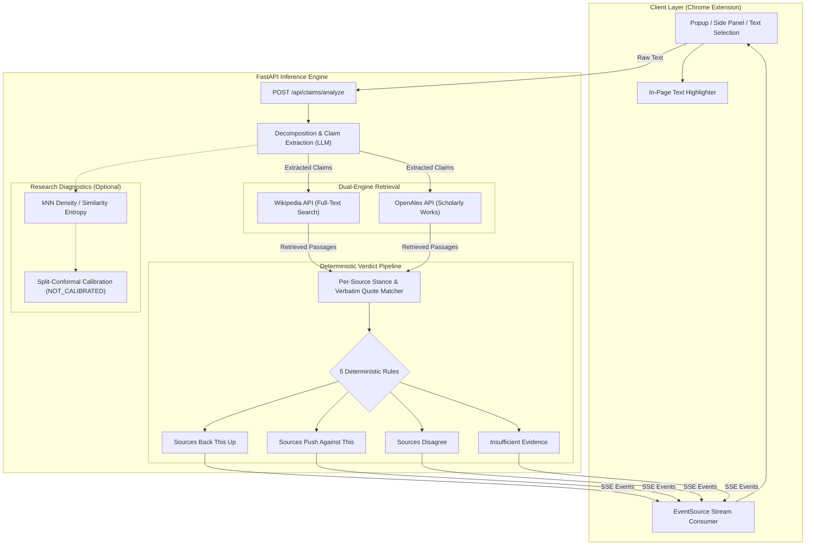

# Synthetic Silence 2.0

> **Evaluating Claim-Space Density for Evidence Insufficiency Under Construction and Reference-Manifold Shift**  
> *An empirical investigation into representation-space uncertainty signals, paired with a deterministic, evidence-grounded verification system.*

[](https://www.python.org/)
[](LICENSE)
[](tests/)
[](extension/)
[](docs/)

---

## 1. Research Overview & Problem Statement

Large language models (LLMs) frequently generate unsubstantiated assertions when confronted with information voids—a failure mode distinct from factual falsehoods. A prominent hypothesis in representation-space uncertainty estimation posited that **topological density** within an embedding manifold (e.g., $k$-Nearest Neighbor distances or Mahalanobis distance) can act as an unsupervised indicator of whether empirical evidence exists for a claim.

**Synthetic Silence** conducted a multi-phase, controlled empirical investigation into this hypothesis. We evaluated whether claim-space density ($B_3$) serves as an invariant indicator of evidence insufficiency or whether it is structurally entangled with dataset construction heuristics and reference-manifold geometry.

### Core Empirical Findings

```
  FEVER Benchmark (E0)                AVeriTeC Real-World Claims (E1)
┌─────────────────────────────────┐   ┌─────────────────────────────────┐
│ AUROC = 0.5463 [0.5366, 0.5564] │   │ AUROC = 0.2754 (Insufficiency)  │
│ Modest association on templated │──▶│ Severe signal inversion:        │
│ Wikipedia synthetic claims.     │   │ insufficient claims cluster     │
└─────────────────────────────────┘   │ closer to the reference manifold│
                                      └─────────────────────────────────┘
                                                       │
                                      Cross-Manifold Diagnostic (F1)
                                      ┌─────────────────────────────────┐
                                      │ AUROC ≈ 0.50 (Chance level)     │
                                      │ Inversion persists across       │
                                      │ matched controls (F2: 0.3353)   │
                                      └─────────────────────────────────┘
```

1. **E0 (FEVER Baseline, $N = 18,631$):** Claim-space density yielded a modest, statistically significant association ($\text{AUROC} = 0.5463$, 95% CI $[0.5366, 0.5564]$).
2. **E1 (AVeriTeC Stress Test, $N = 500$ Test, $N = 2,384$ Dev):** On naturalistic, multi-hop claims from real-world journalistic fact-checkers, the signal **severely inverted** ($\text{AUROC} = 0.3545$ overall; $\text{AUROC} = 0.2754$ for `retrieved_insufficient`). Insufficient claims were *closer* to the supported manifold than refuted claims.
3. **F1 (Cross-Manifold Evaluation):** Evaluating FEVER claims against an AVeriTeC manifold and vice-versa collapsed cross-domain discrimination to random chance ($\text{AUROC} = 0.4959$ and $0.5019$).
4. **F2 (Matched Controls, 29 Pairs):** 1:1 Mahalanobis nearest-neighbor matching on length and lexical diversity (0.5 SD caliper) failed to resolve the inversion ($\text{AUROC} = 0.3353$, 95% CI $[0.2007, 0.4804]$).

**Conclusion:** Representation-space density does not provide a robust, construction-invariant signal for evidence insufficiency. Rather than treating density as a trusted metric, **Synthetic Silence 2.0** pivots to a deterministic, evidence-grounded verification architecture: retrieving real source passages, extracting verbatim quotes, applying deterministic stance rules, and bounding uncertainty via split-conformal prediction.

---

## 2. Master Results Table

Every number below is tied directly to frozen evaluation manifests recorded in [`results/FINAL_RESEARCH_FREEZE/`](results/FINAL_RESEARCH_FREEZE/) and [`results/FINAL_PAPER_PACKAGE/`](results/FINAL_PAPER_PACKAGE/):

| Phase | Benchmark | Target Condition | Reference Manifold | Instances ($N$) | AUROC | AUPRC | 95% Confidence Interval | Scientific Interpretation |
|:---|:---|:---|:---|:---:|:---:|:---:|:---:|:---|
| **E0** | FEVER | `missing_evidence` | FEVER ($N=10\text{k}$) | 18,631 | **0.5463** | 0.2731 | $[0.5366, 0.5564]$ | Modest signal on synthetic claims |
| **E1** | AVeriTeC | `mixed` | AVeriTeC ($n=671$) | 500 | **0.3545** | 0.1117 | $[0.2925, 0.4215]$ | Direction inconsistent |
| **E1** | AVeriTeC | `retrieved_insufficient` | AVeriTeC ($n=671$) | 35 | **0.2754** | 0.0501 | — | Severe signal inversion |
| **E1** | AVeriTeC | `contradictory` | AVeriTeC ($n=671$) | 38 | **0.4273** | 0.0760 | — | Below chance |
| **E1** | AVeriTeC | `rare_valid` | AVeriTeC ($n=671$) | 122 | **0.4637** | — | — | Diagnostic control |
| **F1** | Cross-Domain | FEVER $\to$ AVeriTeC | AVeriTeC | — | **0.5019** | — | — | Collapsed to chance |
| **F1** | Cross-Domain | AVeriTeC $\to$ FEVER | FEVER | — | **0.4959** | — | — | Collapsed to chance |
| **F2** | Matched | 1:1 Covariate Matched | AVeriTeC | 29 pairs | **0.3353** | — | $[0.2007, 0.4804]$ | Inversion persists after matching |

*Note: Baselines B0 (Random), B1 (Constant), and B5 (Length) all achieved AUROC = 0.5000 on E0.*

---

## 3. System Architecture

The deployed system connects a streaming FastAPI backend to a Manifest V3 Chrome Extension client.



### Deterministic Verdict Rules
Rather than taking a black-box LLM judgment, the pipeline applies 5 formal rules over retrieved sources:
1. **Strong Support:** Multiple authoritative sources provide corroborating quotes with zero contradictory evidence.
2. **Refuted:** At least one decisive source directly pushes against the claim with an attributed excerpt.
3. **Conflicting Evidence:** Both supportive and refuting sources are retrieved; the system explicitly presents both sides.
4. **Insufficient Evidence:** Sources are either tangential, uninformative, or missing.
5. **Budget Exhaustion:** If live retrieval APIs hit quota limits, the system raises an explicit `BUDGET_EXHAUSTED` error rather than hallucinating an absence of evidence.

---

## 4. Repository Structure

```
synthetic-silence/
├── README.md                          # Research landing page & documentation
├── LICENSE                            # MIT License
├── CITATION.cff                       # Citation metadata
├── CHANGELOG.md                       # Release notes and history
├── CONTRIBUTING.md                    # Research contribution guidelines
├── pyproject.toml                     # Python packaging & build configuration
├── requirements.txt                   # Root dependency declaration
├── .gitignore                         # Comprehensive Python/Node/OS exclusions
├── .gitattributes                     # Cross-platform line endings & binary rules
├── .editorconfig                      # Universal code style specification
│
├── backend/                           # Verification backend & core algorithms
│   ├── app/
│   │   ├── main.py                    # FastAPI entrypoint
│   │   ├── api/routes.py              # Streaming API endpoints
│   │   ├── services/algo/             # Density, NLI, Stance, Uncertainty modules
│   │   └── services/analysis/         # Calibration & Temporal feature extractors
│   ├── experiments/                   # Evaluation runners & dataset adapters
│   ├── tests/                         # 117 unit, integration, and regression tests
│   └── requirements.txt               # Backend requirements
│
├── extension/                         # Chrome Extension (Manifest V3)
│   ├── src/                           # TypeScript sources (popup, side panel, views)
│   ├── test/                          # 44 Node test-runner unit tests
│   ├── e2e/                           # Headless Chrome end-to-end suite
│   └── manifest.json                  # Extension manifest
│
├── paper/                             # Academic manuscripts & build scripts
│   ├── content.py                     # IEEE conference draft sources
│   ├── build_paper.py                 # IEEE docx / LaTeX generator
│   ├── journal/                       # TACL Journal manuscript & 5 formal proofs
│   │   ├── content_journal.py         # Full text & theorem formulations
│   │   ├── build_journal.py           # Journal docx / LaTeX generator
│   │   └── FORMAT_NOTES.md            # TACL submission standards
│   └── out/                           # Compiled PDFs, DOCX, and figure assets
│
├── data/                              # Benchmark data & manifolds
│   ├── manifolds/                     # Precomputed embeddings (FEVER, AVeriTeC)
│   ├── processed/                     # DEV and TEST quarantined populations
│   └── raw/                           # Original benchmark sources and manifests
│
├── results/                           # Immutable experiment records
│   ├── FINAL_RESEARCH_FREEZE/         # Frozen manifests, master tables, boundary logs
│   ├── FINAL_PAPER_PACKAGE/           # Discovery manifests, audit matrices, timeline
│   ├── E0_baseline.../                # E0 execution records & error analyses
│   ├── E1_execution/                  # E1 execution logs & threshold locks
│   ├── F1_cross_manifold/             # F1 cross-manifold results & figures
│   └── F2_matched_controls/           # F2 propensity-matched control analysis
│
├── docs/                              # Formal research protocol documents
│   ├── RESEARCH_INTEGRITY_AUDIT.md    # Formal mathematical audit & naming corrections
│   ├── SCIENTIFIC_REGRESSION.md       # Synthetic regression cases (A–I)
│   ├── VERDICT_EVALUATION.md          # FEVER verdict evaluation & McNemar tests
│   └── E1_PROTOCOL.md                 # AVeriTeC quarantine protocol
│
├── scripts/                           # Reproducibility runners & utilities
│   ├── run_e1_evaluation.py           # Execute frozen E1 evaluation
│   ├── run_f1_cross_manifold.py       # Execute F1 cross-manifold experiment
│   ├── run_f2_matched_controls.py     # Execute F2 matching algorithm
│   └── export_openapi.py              # Export OpenAPI schema for TypeScript binding
│
└── .github/
    └── workflows/
        └── tests.yml                  # Cross-platform CI (Linux, macOS, Windows)
```

---

## 5. Cross-Platform Installation & Quick Start

The repository is fully cross-platform and verified on **macOS (Apple Silicon & Intel)**, **Ubuntu Linux**, and **Windows (PowerShell)**.

### 5.1 Python Environment (Backend & Research Experiments)

```bash
# 1. Clone repository
git clone https://github.com/thrilokmanjunath/SyntheticSilence2.0.git
cd SyntheticSilence2.0

# 2. Set up virtual environment
# macOS / Linux:
python3 -m venv .venv
source .venv/bin/activate

# Windows PowerShell:
py -m venv .venv
.\.venv\Scripts\Activate.ps1

# 3. Install dependencies
python -m pip install --upgrade pip
pip install -r requirements.txt

# 4. Configure environment
cp backend/.env.example backend/.env
# Edit backend/.env to provide OPENROUTER_API_KEY
```

### 5.2 Running the Backend Server

```bash
python -m uvicorn app.main:app --app-dir backend --port 8000 --reload
```
Check health: `curl http://localhost:8000/health`.

### 5.4 Benchmark Reproduction & Research Demonstration

#### Single-Command Offline Benchmark Reproduction
All frozen research manifests and empirical metrics can be verified offline with zero API calls:

```bash
# Verify frozen manifests, checksums, E0 (0.5463) and E1 (0.2754) metrics
python scripts/reproduce_benchmark.py
```
This generates `results/REPRODUCIBILITY_AUDIT_REPORT.json` validating:
- **Target Metric 1**: FEVER E0 B3 kNN Density AUROC = `0.5463` (95% CI: `[0.5366, 0.5564]`, Prevalence Baseline: `0.2403`).
- **Target Metric 2**: AVeriTeC E1 `retrieved_insufficient` Sub-Class AUROC = `0.2754` (Severe Signal Inversion where insufficient claims cluster closer to the reference manifold).
- **Cross-Manifold Diagnostics (F1)**: FEVER $\to$ AVeriTeC AUROC = `0.5019`; AVeriTeC $\to$ FEVER AUROC = `0.4959` (collapses to random chance).
- **Matched Controls (F2)**: 1:1 Mahalanobis matched pairs AUROC = `0.3353` (inversion persists after balancing length and lexical diversity).

#### Interactive Research Demo (Streamlit)
Launch the local demonstration interface:
```bash
streamlit run streamlit_app.py
```
*Features:* Claim & retrieved evidence inspection, deterministic stance & quote evaluation, conformal prediction sets ($1 - \alpha$), and preset benchmark cases reproducing the empirical signal inversion.

#### Video Walkthrough
A complete 2-minute video presentation storyboard and recording guide is available in [`docs/WALKTHROUGH_SCRIPT.md`](docs/WALKTHROUGH_SCRIPT.md).

## 6. Testing & Reproducibility

The repository includes a comprehensive 195-test suite verifying mathematical invariants, data-leakage quarantine, and end-to-end integration:

```bash
# 1. Backend tests (117 tests: unit, integration, leakage, synthetic regression Cases A-I)
pytest -q backend/tests

# 2. Paper tests (34 tests: proposition proofs, Ledoit-Wolf shrinkage, confusion matrices)
pytest -q paper/test_mathtext.py paper/test_journal_content.py paper/test_propositions.py

# 3. Chrome Extension tests (44 tests: types, parsing, UI state, Markdown generation)
cd extension && npm test
```

### Reproducing Benchmark Experiments

All frozen research manifests can be audited and verified without re-running expensive LLM inferences:

```bash
# Check E0 baseline metrics
python scripts/e0_post_analysis.py

# Run E1 post-hoc failure attribution
python scripts/e1_post_analysis.py

# Re-run F1 cross-manifold analysis
python scripts/run_f1_cross_manifold.py

# Re-run F2 covariate matching (Mahalanobis distance)
python scripts/run_f2_matched_controls.py
```

---

## 7. Research Manuscripts & Artifacts

- **TACL Journal Manuscript:** [`paper/out/SyntheticSilence_Journal_Draft.pdf`](paper/out/) — 9 pages following the MIT Press TACL format, including 5 formal propositions with proofs on manifold density, cosine similarity entropy, and Ledoit-Wolf shrinkage.
- **IEEE Conference Draft:** [`paper/out/SyntheticSilence_IEEE_Draft.pdf`](paper/out/) — 6-page two-column conference submission layout.
- **Research Work Diary:** [`review1/Research_Work_Diary.pdf`](review1/) — Complete empirical progression log.
- **Academic Presentation:** [`review1/SyntheticSilence_RI_Review1.pdf`](review1/) / [`Synthetic_Silence_Final_Presentation.pptx`](Synthetic_Silence_Final_Presentation.pptx).

---

## 8. Limitations & Threats to Validity

1. **Domain & Syntax Confounding:** High representation density in FEVER is partially an artifact of simple Wikipedia sentence structures. In naturalistic corpora (AVeriTeC), complex syntax places well-grounded claims into sparse representation regions.
2. **Sample Size in Matched Controls (F2):** Strict 0.5 SD caliper matching yielded 29 pairs. While post-match standardized mean difference was below 0.02, bootstrap confidence intervals remain relatively wide ($[0.2007, 0.4804]$).
3. **Retrieval Budget Sensitivity:** Real-time retrieval against academic APIs (OpenAlex) is subject to rate-limiting; systems must isolate budget exhaustion from genuine information voids.
4. **Conformal Calibration Status:** Calibration is implemented via split-conformal quantile estimation, but defaults to `NOT_CALIBRATED` until fitted on target task distributions.

---

## 9. Authors & Ownership

- **Thrilok M** — Department of Data Science, CHRIST (Deemed to be University) ([GitHub](https://github.com/thrilokmanjunath) • [Email](mailto:thrilokmanjunath@gmail.com))
- **Piush Kole** — Department of Data Science, CHRIST (Deemed to be University)

This research project and all associated code, experimental manifests, and documentation are conceived, authored, and owned by **Thrilok M** and **Piush Kole**.

---

## 10. Citation

If you use Synthetic Silence in your research, please cite:

```bibtex
@article{manjunath2026syntheticsilence,
  author    = {Manjunath, Thrilok and Kole, Piush},
  title     = {Synthetic Silence: Evaluating Claim-Space Density for Evidence Insufficiency Under Construction and Reference-Manifold Shift},
  journal   = {Transactions of the Association for Computational Linguistics (Under Review)},
  year      = {2026},
  url       = {https://github.com/thrilokmanjunath/SyntheticSilence2.0}
}
```

---

## 11. License

- Source code is released under the [MIT License](LICENSE).
- Manuscripts and documentation are provided for academic research and evaluation.
